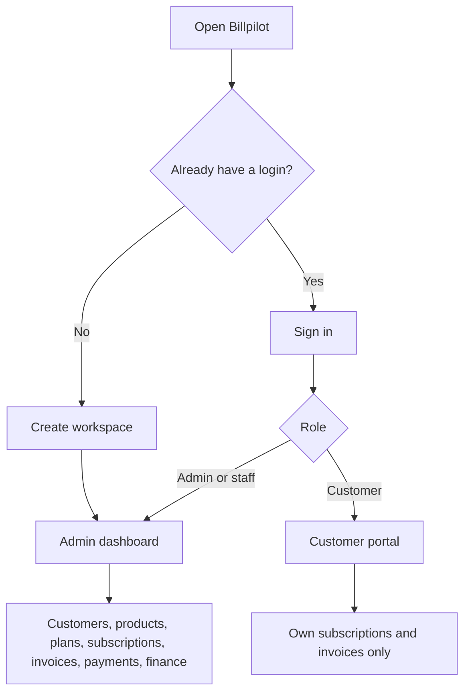
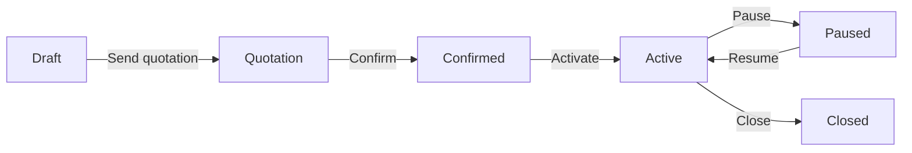
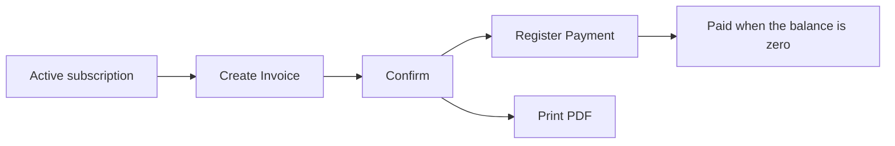

# Billpilot

Billpilot is a subscription billing workspace. A company keeps its own customers, products, plans, subscriptions, invoices, and payments in one place. A customer login sees only that customer’s subscriptions and invoices.

Live demo: [https://billpilot-v1.vercel.app](https://billpilot-v1.vercel.app)

Built for the Odoo x FLUX Lucknow Hackathon ’26.

## Try the demo

Open the site and sign in. Admin and staff land on the company dashboard. A customer lands on their portal.

| Who | Email | Password | Lands on |
| --- | --- | --- | --- |
| Admin | admin@billpilot.com | Admin#Pass123 | Dashboard |
| Staff | staff1@billpilot.com | Staff#Pass123 | Dashboard |
| Staff | staff2@billpilot.com | Staff#Pass123 | Dashboard |
| Customer | meera.iyer@northwind.example | Customer#Pass123 | Portal |
| Customer | rahul.nair@lakshmitextiles.example | Customer#Pass123 | Portal |
| Customer | ananya.bose@gangeslogistics.example | Customer#Pass123 | Portal |
| Customer | vikram.reddy@deccanhealth.example | Customer#Pass123 | Portal |
| Customer | sana.qureshi@himalayaedu.example | Customer#Pass123 | Portal |

**Log out** is in the top bar, next to the name. It ends the session and returns to the public page.

The signed-in home page shows live totals for that login: company cash, amounts owed, MRR, and ARR for admin and staff; the customer’s own subscriptions, open invoices, and balance due for a customer. Each card opens the list behind the number.

## Who goes where



Create workspace is for a new company. It makes that company and its first admin. It does not create a customer. Customers are added later from the dashboard, and a portal password on that form is what lets the customer sign in.

A new password needs at least 9 characters, one uppercase letter, one lowercase letter, and one symbol.

## Use guide

### 1. Open a company

On the public page, choose **Create workspace**. Enter the company name and the admin’s name, email, and password. Sign-in then opens the dashboard for that company only. Another business that signs up gets a separate workspace and cannot see these records.

The demo company is already loaded. Use the admin login above and skip this step.

### 2. Read the dashboard

The dashboard shows, for this company:

- active subscriptions
- cash collected this month
- amount still owed, including overdue
- overdue amount
- MRR and ARR

**Run billing cycle** is on this page for the admin. It creates invoices that are due. Staff do not see that button.

### 3. Add the records a subscription needs

From the left menu:

1. **Customers.** Company, contact, email, and an optional portal password.
2. **Products.** Name and price. The demo catalog includes Billpilot products, with an Odoo Brand option at +560.
3. **Plans.** Daily, weekly, monthly, or yearly.
4. **Subscriptions.** Pick the customer, plan, and product. The new subscription starts as **Draft**.

The demo already has five customers, products, plans, 25 subscriptions, and 35 invoices. Use those, or add your own.

### 4. Move a subscription forward

Open the subscription. The buttons follow the status. A step cannot be skipped.



- **Send quotation** needs a customer name, contact, email, and at least one product line.
- **Confirm** is refused after the quotation validity date.
- **Pause** and **Close** depend on the plan. A plan can disallow pause or early close.
- **Closed** is the end. It does not move again.

### 5. Create the bill and take payment

On an **Active** subscription, choose **Create Invoice**. Then open the invoice:



**Register Payment** reduces the balance. The invoice becomes **Paid** when nothing is left. **Print PDF** downloads the invoice.

The customer can open **Invoices** in the portal and download the same PDF. They cannot see another customer’s invoices, and they cannot confirm, pay, or edit company records.

### 6. Finance

**Finance** repeats the dashboard totals and charts them: cash by month, and MRR by billing interval. MRR treats a daily plan as ×30, a weekly plan as ×4.33, a monthly plan as itself, and a yearly plan as ÷12. ARR is MRR ×12.

## What each login can do

| | Admin | Staff | Customer |
| --- | --- | --- | --- |
| Dashboard, customers, products, plans, subscriptions, invoices, payments, discounts, finance | Yes | Yes | No |
| Send quotation, confirm, activate, pause, close | Yes | Yes | No |
| Create invoice, confirm invoice, register payment, print PDF | Yes | Yes | Print own PDF only |
| Run billing cycle | Yes | No | No |
| Add staff | Yes | No | No |
| See another company’s data | No | No | No |

## Team

| Member | Role | Main responsibility |
| --- | --- | --- |
| Vineet Pandey | Team Leader | Project setup, login and roles, GitHub, merging, deployment, final demo |
| Vineet Shukla | Backend Developer | Products, variants, plans, templates, subscriptions and status flow |
| Vansh Chaudhry | Backend Developer | Tax, discounts, invoice engine, payments, billing job, seed data |
| Yashraj Rastogi | Frontend Developer | UI design, finance dashboard, customer portal, invoice print/PDF |

## Run it locally

Requirements: Node.js 20+, Docker.

```bash
docker compose up -d
copy .env.example .env
npm install
npx prisma migrate dev
npx prisma db seed
npm run dev
```

The app is at [http://localhost:3000](http://localhost:3000). Postgres listens on port 5432 with user, password, and database `billpilot`. Set `AUTH_SECRET` in `.env` to a random string of at least 32 characters before relying on login.

`npx prisma db seed` wipes the database and loads the demo company again. Do not run it against a database you need to keep.

Stack: Next.js 15, React 19, TypeScript, Tailwind CSS, shadcn/ui, PostgreSQL 16, Prisma.
